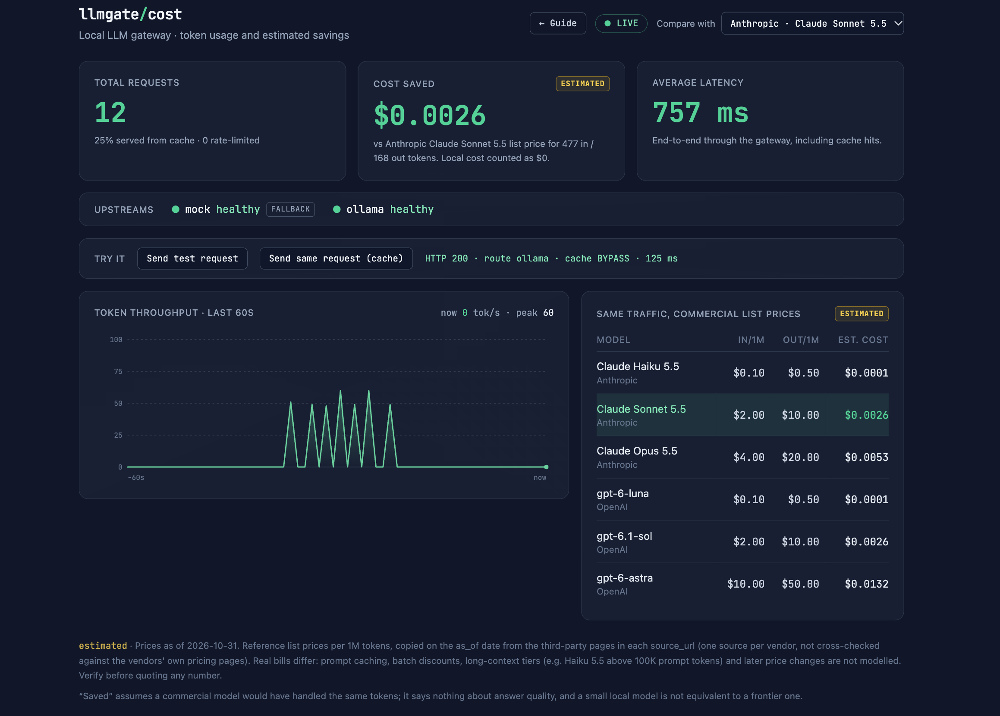
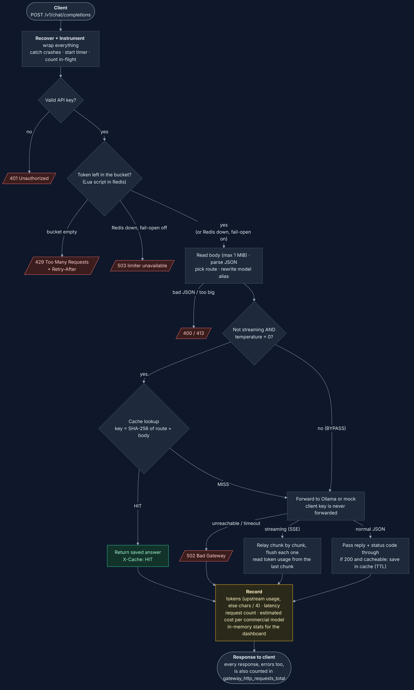

# llmgate

[](https://github.com/priyansh-0304/llmgate/actions/workflows/ci.yml)
[](LICENSE)

A small, resource-efficient **LLM gateway in Go**. It sits between your app and a language model and adds rate limiting, response caching, retries with a circuit breaker and fallback, per-key token budgets, Prometheus metrics and alerts, a Grafana board, and a React **estimated cost-savings dashboard**. It runs entirely on your laptop with no paid API: requests go to a local CPU model (Ollama, which embeds llama.cpp) or to a configurable mock upstream for load tests.

**New to the project?** Open the [guide page](https://priyansh-0304.github.io/llmgate/). It explains every part in plain language and has an in-browser simulator. When you run the stack locally, the same page is at http://localhost:3000.



## What it does

- **Auth and rate limiting:** API-key check, then a Redis token bucket (atomic Lua script) per key.
- **Caching:** identical deterministic requests (`temperature: 0`, not streaming) are answered from Redis.
- **Resilience:** retries with exponential backoff and jitter, a per-route circuit breaker, and automatic fallback to a second upstream.
- **Token budgets:** a per-key token allowance per time window (`429 insufficient_quota`).
- **Streaming:** Server-Sent Events are relayed chunk by chunk while token usage is read from the final chunk.
- **Observability:** Prometheus metrics, 9 alert rules, a provisioned Grafana board, request IDs through logs and upstream calls.
- **Cost dashboard:** tokens, latency and what the same traffic would have cost on commercial models, always labelled `estimated`.

```
client ──► gateway (Go) ──► Ollama (local quantized model, CPU)
             │    │    └──► mock-upstream (fake OpenAI server, for load tests)
             │    └── Redis: token-bucket rate limit + response cache + budgets
             ├── /metrics ──► Prometheus ──► Grafana
             └── /api/stats ──► Dashboard (React + Tailwind)
```



More diagrams and a table mapping each system-design idea to its code are in [docs/ARCHITECTURE.md](docs/ARCHITECTURE.md).

## Quick start

Pick one. All of them bind to `127.0.0.1` only.

**A. Go only, no Docker (best for learning).** Needs Go 1.22+.
```bash
make tidy                 # downloads the dependencies, writes go.sum (once)
make test
make run-mock             # terminal 1: fake upstream on :9000
DEMO_ENDPOINT=true make run-gateway   # terminal 2: gateway on :8080 (in-memory limiter/cache, no auth)
make dashboard-dev        # terminal 3: dashboard on :5173/dashboard/ (needs Node 20+; run `npm install` in dashboard/ first)
curl -s localhost:8080/v1/chat/completions -d '{"model":"mock-fast","messages":[{"role":"user","content":"hi"}]}'
```

**B. Docker Compose.** Full stack, mock upstream by default.
```bash
make compose-up           # generates .env with random secrets, builds, starts
# Real local model instead:  DEFAULT_ROUTE=ollama docker compose --profile ollama up --build
```

**C. kind (Kubernetes in Docker).** Needs `kind`, `kubectl`, `docker` (`brew install kind kubectl` on macOS). Stop Docker Compose first: both use the same ports.
```bash
make up                   # secrets → cluster → build images → load into kind → apply manifests
make status               # wait until pods are Running (Ollama's image and model download take a while)
make down                 # delete the cluster when you are done
```
If a pod stays in `ContainerCreating`, see [Troubleshooting](#troubleshooting).

| What | URL |
|---|---|
| Gateway | http://localhost:8080 |
| Guide page (explains the project, with a simulator) | http://localhost:3000 |
| Cost dashboard | http://localhost:3000/dashboard/ (dev server: http://localhost:5173/dashboard/) |
| Grafana | http://localhost:3001 (user `admin`, password in `.env` / `secret.local.yaml`) |
| Prometheus | http://localhost:9090 (alert rules at `/alerts`) |
| Mock upstream | http://localhost:9000 |

### Calling the gateway

```bash
KEY=$(grep ^GATEWAY_API_KEY .env | cut -d= -f2)
curl -s localhost:8080/v1/chat/completions -H "Authorization: Bearer $KEY" \
  -d '{"model":"local","temperature":0,"messages":[{"role":"user","content":"Say hello"}]}'
```
Model `local` means "whatever the route's default model is". Model names starting with `mock` go to the mock upstream; you can also force a route with the header `X-LLM-Route: ollama|mock`. Response headers `X-Cache` (HIT/MISS/BYPASS), `X-Gateway-Route`, `X-RateLimit-Remaining` and `X-Request-ID` show what happened. Send your own `X-Request-ID` (letters, digits, `-_.`, up to 64 chars) to trace a request; otherwise one is generated. It is forwarded to the upstream and appears in the gateway's JSON logs.

### The dashboard's "Try it" buttons

The dashboard has **Send test request** and **Send same request (cache)** buttons that send real requests through the gateway, so you can watch the numbers move without using `curl`. The browser never holds a key: the buttons call `POST /api/demo`, and the gateway adds its own key to one of two fixed requests.

This endpoint is **off by default** (`DEMO_ENDPOINT=false`). It is turned on in `docker-compose.yml` and the kind ConfigMap because those only listen on localhost. Do not enable it on anything reachable by other people.

## Performance

Measured with k6 at a constant 100 requests/s for 1 minute, on a laptop, against the **mock upstream** (about 25 ms per reply), with the rate limit raised so nothing was rejected:

| Latency | Direct to mock | Through gateway | Gateway adds |
|---|---|---|---|
| p95 | 31.93 ms | 32.64 ms | about 0.7 ms |
| p99 | 33.35 ms | 34.63 ms | about 1.3 ms |

Both runs had 0% failed requests. About 30% of the gateway run were cache hits (answered in under 1 ms), which is why the gateway's *average* is lower than direct; p95 and p99 describe the slowest requests, which are the cache misses that reached the mock. These numbers show the gateway's own overhead. They say nothing about real model speed: a CPU model takes seconds per reply. Reproduce with `make loadtest-mock` and `make loadtest-gateway`.

## Load testing (p95 / p99 without external 429s)

```bash
make loadtest-mock        # baseline against the mock directly
make unlimit              # raise the gateway's rate limit (kind), route to mock
make loadtest-gateway     # same test through the gateway
make limit                # restore defaults
```
Needs [k6](https://k6.io) (`brew install k6`). On Docker Compose, raise the limit instead with `RATE_CAPACITY=100000 RATE_REFILL_PER_SEC=100000 DEFAULT_ROUTE=mock docker compose up -d --build`. k6 prints p(95)/p(99) and thresholds fail the run if p95 > 500 ms or p99 > 1 s. Tune with `-e RATE=200 -e DURATION=30s -e MODEL=mock-slow -e CACHE_RATIO=0.5`. The mock has presets: `mock-fast`, `mock-slow` (~1 s), `mock-flaky` (10% 500s), `mock-down` (always 500, for the resilience demos below), plus env vars `MOCK_LATENCY`, `MOCK_JITTER`, `MOCK_ERROR_RATE`, `MOCK_COMPLETION_TOKENS`. Gateway-side 429s are counted separately (`gateway_rate_limited`) from real failures. Don't load-test the Ollama route: a CPU model handles roughly one request at a time.

## Resilience and budgets

All off or conservative by default; set as environment variables (docker compose passes them through, kind reads them from the `gateway-config` ConfigMap).

| Variable | Default | Meaning |
|---|---|---|
| `FALLBACK_ROUTE` | empty (none) | `mock` or `ollama`: route to try when the chosen one fails. It uses its own default model and its answers are never cached under the primary route's key |
| `MAX_RETRIES` | `1` (0 to 5) | Extra attempts per route on 5xx or connection errors, with exponential backoff and jitter. Never on 4xx and never on timeouts |
| `RETRY_BACKOFF` | `100ms` | Base delay for the backoff |
| `BREAKER_FAILURES` | `5` (0 = off) | Consecutive failures that open a route's circuit breaker |
| `BREAKER_COOLDOWN` | `30s` | How long a circuit stays open before one probe request is let through (half-open) |
| `TOKEN_BUDGET` | `0` (off) | Tokens each API key may use per window; over it you get `429 insufficient_quota` |
| `TOKEN_BUDGET_WINDOW` | `24h` | Length of the budget window |
| `DEMO_ENDPOINT` | `false` | Enables `POST /api/demo` for the dashboard's "Try it" buttons (local demos only) |

How it behaves: when a route's circuit is open the gateway skips it instantly (fail fast). With a fallback configured the request goes there; without one the client gets `503` + `Retry-After`. The budget is checked before a request and charged after it, so the last allowed request can overshoot slightly (we cannot know the cost in advance). Cache hits are free. Budgets live in Redis (in memory when running without Redis).

**Try it (Go only, no Docker):**
```bash
make run-mock                                       # terminal 1
# terminal 2: ollama is not running, so it fails and the mock takes over
DEFAULT_ROUTE=ollama OLLAMA_URL=http://localhost:19999 FALLBACK_ROUTE=mock \
  BREAKER_FAILURES=3 BREAKER_COOLDOWN=60s MOCK_URL=http://localhost:9000 go run ./cmd/gateway
for i in 1 2 3 4 5 6; do curl -s -o /dev/null -w "%{http_code}\n" localhost:8080/v1/chat/completions \
  -d '{"model":"x","messages":[{"role":"user","content":"hi '$i'"}]}'; done   # all 200 via the fallback
curl -s localhost:8080/api/stats | grep -A8 '"routes"'                          # ollama: open, mock: closed
```
Without a fallback, send model `mock-down` to see retries, then `500`s, then `503`s once the circuit opens. For the budget, run with `TOKEN_BUDGET=300` and send distinct prompts until you get a 429.

**Alerts.** `deploy/k8s/files/alerts.yml` has 9 Prometheus rules (gateway down, upstream error rate, p99 latency, circuit open, fallback active, retries elevated, high 429 rate, token-budget rejections, Redis errors). They show at http://localhost:9090/alerts. There is no Alertmanager, so nothing is sent anywhere; adding one is the next step if you want notifications.

## Metrics

| Metric | Type | Labels |
|---|---|---|
| `llm_tokens_total` | counter | route, model, type (prompt/completion), cache |
| `llm_latency_seconds` | histogram | route, model, cache |
| `llm_requests_total` | counter | route, model, status, cache |
| `llm_estimated_cost_usd_total` | counter | reference (**estimate**, one series per commercial model) |
| `llm_rate_limited_total`, `llm_cache_events_total`, `llm_usage_estimated_total` | counters | |
| `llm_upstream_attempts_total` | counter | route, outcome |
| `llm_retries_total` | counter | route |
| `llm_fallbacks_total` | counter | from, to |
| `llm_circuit_state` | gauge | route (0 closed, 1 open, 2 half-open) |
| `llm_circuit_transitions_total` | counter | route, to |
| `llm_budget_rejected_total`, `llm_budget_errors_total` | counters | |
| `gateway_http_*` | counter / histogram / gauge | method, path, code |

Cache hits count tokens too (labelled `cache="hit"`), because that is what a paid API would have billed.

## Cost numbers are estimates

Prices live in `data/pricing.seed.json` (as of 2026-10-31). They were copied from **third-party price trackers, one source per vendor, and not cross-checked against the vendors' own pricing pages**. Verify before quoting them anywhere. The model does not account for prompt caching, batch discounts, long-context tiers, or electricity for your own machine. "Saved" also says nothing about quality: a 0.5B local model is not equivalent to a frontier model. Every dollar figure in the UI carries an `estimated` badge. When no gateway is reachable the dashboard shows a **DEMO DATA** banner and synthetic numbers from `data/demo-stats.seed.json`.

## Secrets

`scripts/gen-secrets.sh` (via `make env`) writes random values to `.env` and `deploy/k8s/secret.local.yaml`; both are git-ignored and never overwritten. Kubernetes injects them as env vars with `secretKeyRef`. The dashboard holds no credential at all: its nginx proxies `/api/*` to the gateway server-side. `.env` is also excluded from Docker build contexts. Never commit either file; if one ever lands in git history, change the passwords.

## Project layout

```
cmd/gateway/main.go          wires everything together, starts the server
cmd/gateway/demo.go          POST /api/demo for the dashboard's "Try it" buttons (off by default)
cmd/mock-upstream/main.go    fake OpenAI-compatible server
internal/config              env-var settings
internal/proxy               ★ the main handler (routing, retries, fallback, cache, streaming, token accounting)
internal/middleware          recover, Prometheus instrumentation, auth, rate limit, token budget
internal/resilience          circuit breaker + retry backoff
internal/budget              per-key token budget (Redis Lua + in-memory)
internal/reqid               X-Request-ID middleware
internal/ratelimit           token bucket: in-memory + Redis (Lua script)
internal/cache               response cache: Redis + in-memory
internal/metrics             all Prometheus metric definitions
internal/pricing, stats      price table; in-memory numbers for the dashboard
dashboard/                   React + Tailwind UI (served at /dashboard/)
deploy/                      Dockerfile.app, kind config, k8s manifests, Prometheus alerts + Grafana config
loadtest/k6.js, data/        load test, seed data
docs/index.html              the guide page (also served at / by the dashboard container)
docs/ARCHITECTURE.md         diagrams + system-design concepts mapped to code
.github/workflows/ci.yml     gofmt, vet, tests, dashboard build on every push
```

## Testing

```bash
make test                 # go test ./...
go test -race ./...       # also detects data races
gofmt -l .                # should print nothing
```
GitHub Actions runs `gofmt`, `go vet`, `go test -race` and the dashboard build on every push and pull request.

## Troubleshooting

- **`go: command not found`:** install Go (`brew install go` on macOS).
- **`kind` or `kubectl` not found:** `brew install kind kubectl`. Docker Desktop must be running.
- **Dashboard shows DEMO DATA or OFFLINE:** it cannot reach the gateway. Check that the gateway is running and that no second gateway (for example an old `go run`) holds port 8080.
- **I sent requests and the dashboard did not move:** requests rejected with `401` are not counted. Send `-H "Authorization: Bearer $KEY"` (see "Calling the gateway") or use the dashboard's "Try it" buttons.
- **No 429s when testing the limit:** the default limit is 10 requests/second per key with a burst of 20, so it only triggers when you send faster than that, for example with a short `for` loop.
- **Port already in use:** Docker Compose and kind both use 8080, 3000, 3001, 9090 and 9000. Run `docker compose down` before `make up`, and `make down` before `docker compose up`.
- **kind pod stuck in `ContainerCreating`:** the cluster downloads images itself and a download can stall. Check `kubectl -n llmgate describe pod <name>` (the Events at the bottom). Deleting the pod (`kubectl -n llmgate delete pod <name>`) often lets it retry. With Docker Desktop, `kind load docker-image` can fail with "content digest not found"; use `docker save --platform linux/arm64 <image> -o /tmp/x.tar` (or `linux/amd64` on Intel) and `kind load image-archive /tmp/x.tar --name llmgate` instead. `ollama/ollama:latest` is large and can take a long time.
- **`missing go.sum entry`:** run `make tidy` and commit `go.sum`.

## What has and has not been tested

Tested on a Mac (Docker Desktop, Apple Silicon):

- `go test -race ./...` passes for every package that has tests (gateway, budget, middleware, pricing, proxy, ratelimit, reqid, resilience, stats).
- The full Docker Compose stack: gateway, Redis, mock upstream, dashboard, Prometheus (alert rules page) and the Grafana board loaded in a browser.
- A kind cluster built with `make up`: all pods reached `Running`, and a request sent through the gateway returned a real answer from `qwen2.5:0.5b` via Ollama (`X-Gateway-Route: ollama`).
- k6 at 100 req/s against the mock upstream, directly and through the gateway (see [Performance](#performance)).
- The retry, circuit-breaker, fallback, token-budget and request-ID behaviour, with unit tests and by hand with `curl`.

Not tested: Linux and Windows hosts, an Intel Mac, k6 against the real Ollama route (a CPU model handles about one request at a time), more than one gateway replica, and Alertmanager (not included). The `cache`, `config`, `httpx` and `metrics` packages have no unit tests of their own; they are only exercised indirectly through the proxy and middleware tests.

## Known limits

- Circuit-breaker state is per gateway process (not shared between replicas), and the retry count applies per route, so a request can make up to `(MAX_RETRIES+1)` attempts on each of two routes.
- Token budgets only count tokens the upstream reports (or the chars/4 estimate), and are checked before, not during, a request.
- Alerts are rules only: no Alertmanager, so nothing sends an email or message.
- `/api/stats` lives in gateway memory: it resets on restart and the deployment is pinned to one replica. Prometheus/Grafana are the durable record.
- Redis-backed rate limiting is per API key (or client IP when no key); the in-memory fallback never evicts idle buckets.
- Token counts come from the upstream's `usage` block. If it is missing the gateway estimates ~4 chars/token and counts it in `llm_usage_estimated_total`.
- Only `/v1/chat/completions` is proxied (no embeddings, no tool-call-aware accounting).
- No TLS, no user accounts or database: this is a local development tool, not a hardened production gateway.

## New to Go? A reading order for the code

Read the code in this order; each step introduces a few ideas.

1. **`internal/pricing/pricing.go`**: the simplest file. *Packages* group code (`package pricing`); a name starting with a **capital letter is public**, lowercase is private. A **struct** is a bundle of fields (like a class with no methods inside it); **methods** are attached with `func (r Reference) Cost(...)`. The backtick tags (`json:"id"`) map JSON keys to fields. Functions return `(value, error)`; you always check `if err != nil`. There are no exceptions.
2. **`internal/stats/stats.go`**: *concurrency safety*. Every HTTP request runs in its own **goroutine** (a very cheap thread), so shared data needs a `sync.Mutex`. `defer s.mu.Unlock()` runs the unlock when the function exits, however it exits.
3. **`internal/ratelimit/ratelimit.go`**: **interfaces**. `Limiter` is just a method list; any type with an `Allow` method satisfies it automatically (no `implements` keyword). The gateway only knows `Limiter`, so tests and production plug in different implementations. This is how Go does dependency injection.
4. **`internal/resilience/breaker.go`**: a small state machine (closed, open, half-open) guarded by a mutex.
5. **`internal/middleware/middleware.go`**: a **middleware** is a function that takes a handler and returns a wrapped handler. `Chain` stacks them like onion layers. A handler is anything with `ServeHTTP(w, r)`; `http.HandlerFunc` turns a plain function into one.
6. **`internal/proxy/proxy.go`**: the main handler. Follow `ChatCompletions` top to bottom: read body → pick route → check cache → forward (with retries and fallback) → stream or buffer → record metrics. Notice `r.Context()`: when the client disconnects, the context is cancelled and the upstream call aborts.
7. **`cmd/gateway/main.go`**: `go func() {...}()` starts a goroutine; `select` waits on several channels (server error vs. Ctrl+C) for graceful shutdown.
8. **`*_test.go`** files: tests are plain functions named `TestXxx(t *testing.T)`; run with `go test ./...`. `proxy_test.go` spins up a fake upstream with `httptest.NewServer`.

Handy commands: `go run ./cmd/gateway`, `go build ./...`, `go vet ./...` (finds suspicious code), `gofmt -l .` (formatting is not a debate in Go; the tool decides), `go test -race ./...` (detects data races).

## License

MIT, see [LICENSE](LICENSE).