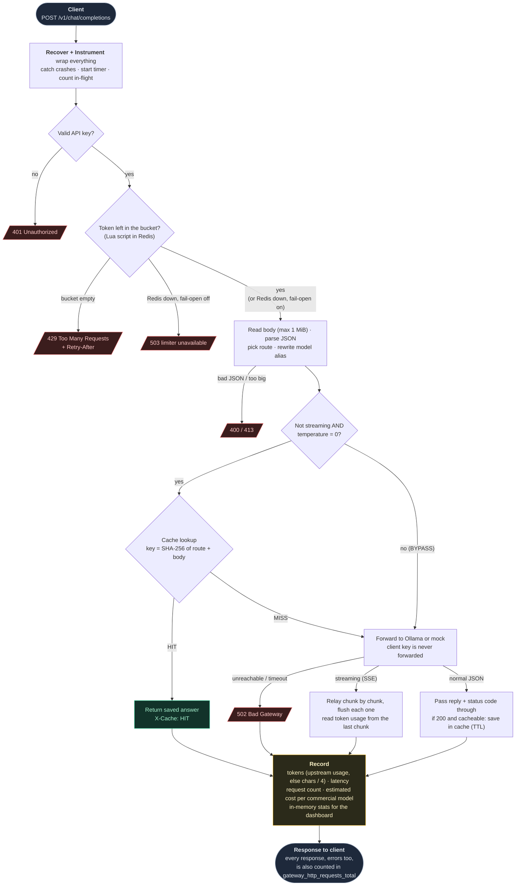
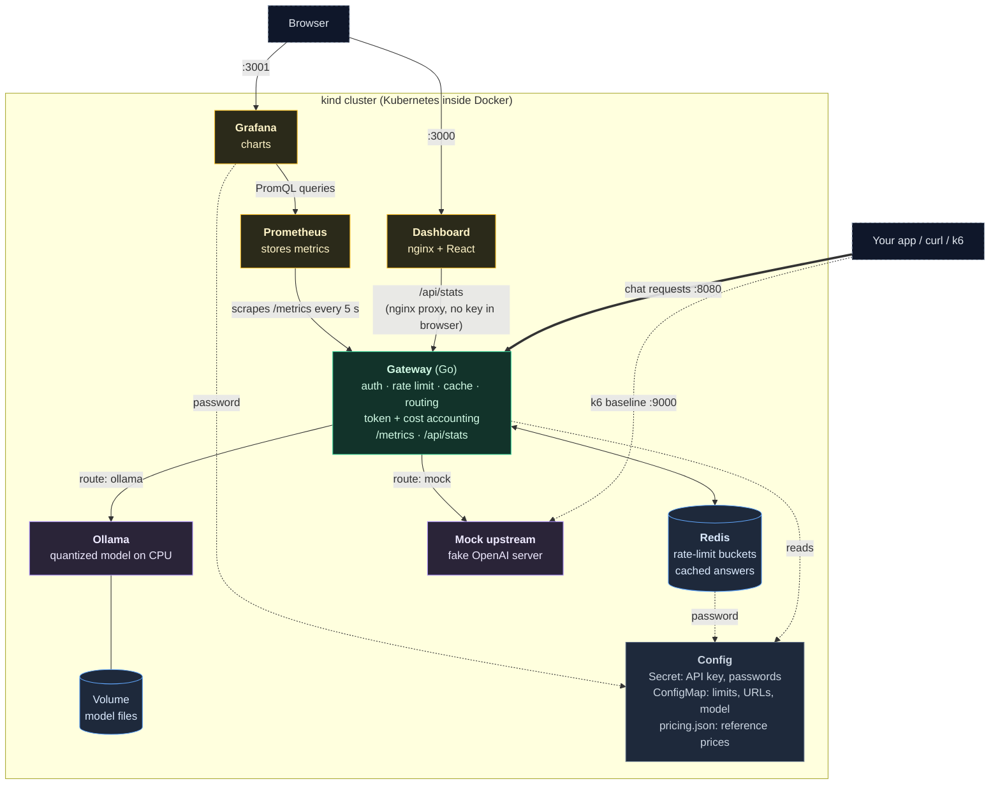

# Architecture

Diagrams are Mermaid, so they render on GitHub. PNG copies are next to this file.

## 1. What happens to one request

Follow `POST /v1/chat/completions` from top to bottom. Red boxes are early exits.
Code: `internal/middleware/middleware.go` (steps 1-3) and `internal/proxy/proxy.go` (everything after).

## 2. System architecture

Code and config: `cmd/gateway`, `deploy/k8s/*.yaml`, `docker-compose.yml`.

## 3. System-design concepts and where they live

| Concept | Where in the code | What it does here |
|---|---|---|
| API gateway / reverse proxy | `internal/proxy/proxy.go` | Single entry point; routes to Ollama or mock, rewrites model alias, never forwards client credentials |
| Middleware chain | `internal/middleware/middleware.go` (`Chain`) | Recover, Instrument, Auth, RateLimit wrap the handler like onion layers |
| Rate limiting (token bucket) | `internal/ratelimit/ratelimit.go`, `redis.go` | Burst of N, sustained R/sec per API key or IP; 429 + `Retry-After` |
| Atomic shared state | `redis.go` (Lua script) | Check-and-spend runs inside Redis, so replicas cannot both take the last token |
| Caching (TTL, deterministic only) | `internal/cache/cache.go`, `proxy.go` | Key = SHA-256 of route + body; only non-streaming `temperature=0`; failures count as a miss |
| Cache eviction | `deploy/k8s/10-redis.yaml` | `maxmemory 128mb`, `allkeys-lru`, no persistence |
| Authentication | `middleware.Auth`, `clientKey` | Constant-time key compare; the key is hashed before use as a Redis key |
| Observability: metrics | `internal/metrics/metrics.go` | Counters, histograms (p95/p99), gauge; Prometheus **pull** model, 5 s scrape (`deploy/k8s/files/prometheus.yml`) |
| Observability: dashboards, logs, health | Grafana provisioning in `deploy/k8s/files/`, `slog` JSON logs, `/healthz` + probes in `40-gateway.yaml` | Visualise, debug, let Kubernetes restart a sick pod |
| Metric cardinality control | `Route.KnownModels` in `proxy.go`, `pathLabel` in middleware | Unknown model names / paths collapse to `other` so a client cannot create unlimited time series |
| Graceful degradation | `RATE_FAIL_OPEN` in `config.go`; cache errors; `main.go`; `dashboard/src/useStats.js` | Redis outage does not take the gateway down; dashboard falls back to labelled demo data |
| Timeouts and size limits | `proxy.go` transport, `main.go` server, `MaxBytesReader`, `LimitReader` | Bound waiting and memory; deliberately no write timeout so streams are not cut |
| Streaming (SSE) | `proxy.go` `relayStream` | Flushes each event; reads token usage from the final chunk |
| Graceful shutdown | `cmd/gateway/main.go` | On Ctrl+C / pod stop, finish in-flight requests |
| 12-factor config | `internal/config/config.go` | All settings from env vars, injected by ConfigMap / Secret |
| Interfaces / dependency inversion | `ratelimit.Limiter`, `cache.Cache` | Same handler runs on Redis or in-memory; makes tests fast |
| Secrets management | `scripts/gen-secrets.sh`, `secret.example.yaml`, `secretKeyRef` | Random local secrets, git-ignored, injected as env vars, absent from images and the browser |
| Same-origin proxy (BFF-style) | `dashboard/nginx.conf.template` | Browser calls `/api/stats` on its own origin; nginx forwards to the gateway, so no key or CORS |
| Containerisation | `deploy/Dockerfile.app` | Multi-stage build, distroless, non-root |
| Orchestration | `deploy/k8s/*.yaml`, `kind-config.yaml` | Deployments, Services, ConfigMap/Secret, PVC for model files, one-off Job to pull the model, resource limits, read-only root FS, ports bound to 127.0.0.1 |
| Load testing | `loadtest/k6.js`, `cmd/mock-upstream` | Constant-arrival-rate (open model) so slow responses do not hide overload; thresholds on p95/p99 |

## 4. Deliberately not included

Single gateway replica (`/api/stats` is in memory), no retries or circuit breaker, no fallback between upstreams or load balancing across several, no per-user quotas or database, no TLS, no autoscaling, no distributed tracing. Each is a reasonable next step.
